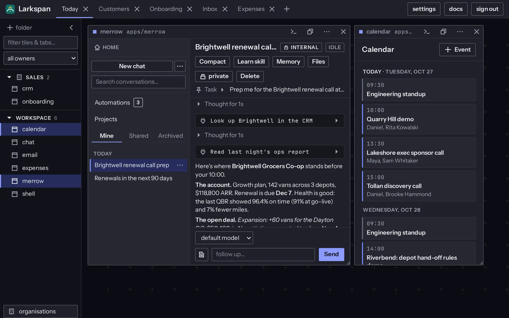
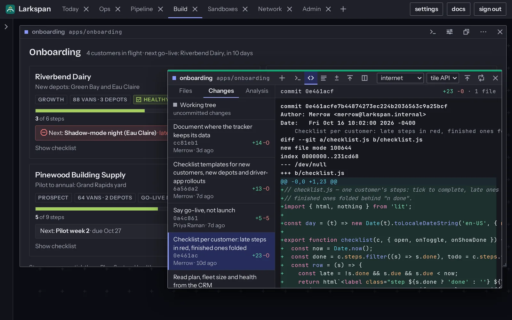
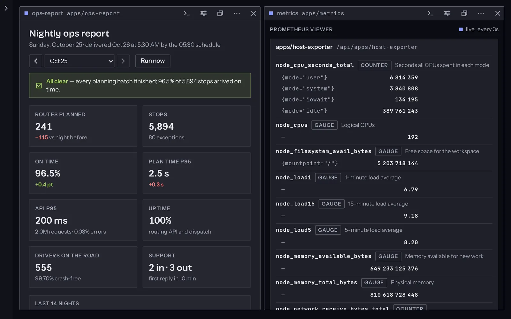
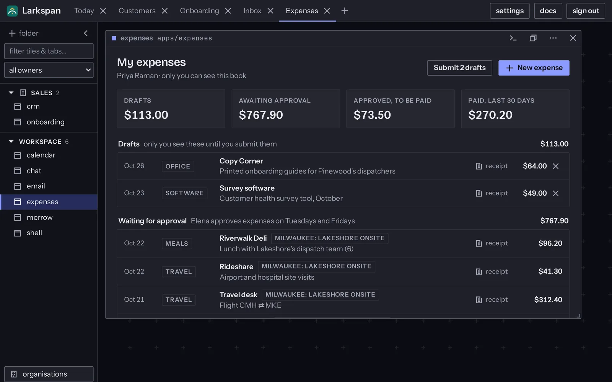

# xbin

**The first exponential era workspace.**

xbin is a workspace where people and AI agents build the systems a company
runs on, and where those systems run. Describe a change to an agent, or make
it yourself: save, and it is live. Every app and every agent works in its own
sandbox and reaches only what someone has granted.



## Try it

An hour, no sign-up, just ssh:

```sh
ssh xbin@vcpu.sh          # or open https://vcpu.sh/xbin
```

Install it on a Linux machine you control (on macOS the installer sets up a
Lima VM). It prints its plan and asks before it changes anything:

```sh
curl -fsSL https://xbin.dev/install.sh | sh
```

System or user mode, what it installs, the first login and running it day to
day: [docs/install.md](docs/install.md).

## What you get

- **An app is a folder.** A page, an optional Go, Node or Python backend, and
  its own git history. Save and the page reloads; a Go backend rebuilds and
  swaps in blue/green. Move the folder to rename the app; copy it to fork it.
- **Agents build them.** The built-in agent runs long tasks with tools and
  subagents, on schedules and triggers, and talks through chat channels. It
  reads PDFs and Office files and writes real spreadsheets, documents and
  decks. Claude Code, Codex, Gemini CLI and opencode work in the workspace
  too, each in its own sandbox, signed in once.
- **A terminal on every app**, in the browser, in that app's directory, as
  that app.
- **Closed until granted.** Each backend and terminal runs in its own
  rootless namespaces over an overlay rootfs, or in a Firecracker microVM.
  Capabilities are dropped, cgroups enforce limits, and outbound network is
  denied until approved, one destination at a time. Every approved grant is
  a line in a plain, versioned file.
- **Apps call apps by role.** An app declares the roles it offers, another
  asks for one, an owner approves once; xbind checks identity on every call.
- **A copy for each person.** An app can run one instance per person: others
  can't read it, and admins don't open it.
- **Batteries.** kv, blob, a live event bus, cron and sqlite per app; an
  encrypted vault; HTTP(S)/TCP/UDP ingress with TLS from a Traefik tile.
- **Ready for IT.** Single sign-on (OIDC or GitHub), organisations, teams and
  policy ceilings, an audit log, a read-only view as any user, encrypted
  backups, limits for each app.
- **Screens your way.** A free canvas, a fixed 48-column grid, a document of
  rows, or tiles that split the screen like a tiling window manager.
- **Three ways in.** The browser, `bx` in a terminal, and the iOS app (in
  beta).

| | |
|---|---|
|  |  |
| An app the agent built, with its commit history open | A Tiled screen: the ops report beside live metrics |
|  | |
| One copy per person: only Priya sees her book | |

*(Screenshots: Larkspan, the fictional company of the demo set in
[hack/demo](hack/demo/README.md).)*

## How it works

```
workspace/
├── xbin.json               the approved grants and bindings, as plain lines
├── apps/crm/               index.html · xbin.json (its roles, what it asks for) · backend/ · .git
├── apps/merrow/            an agent: an app like any other
├── tiles/admin/            the admin console, also an app
└── shell/                  the workspace's own UI: edit it like the rest
```

**xbind** is one Go binary. It serves every app, runs the terminals, watches
files and rebuilds, and is the sandbox runtime itself: it builds each
component's namespaces, overlay rootfs and egress relay, rootless. The
frontend has no build step: plain ES modules, Lit through import maps,
vendored. Each app's page runs in a sandboxed, opaque-origin frame,
attributed by its own frame token (or on its own origin, with
`--tile-assets origins`). The `sdk/` Go module has zero dependencies.

## Docs

Every workspace serves these at `/docs/`.

- [docs/install.md](docs/install.md): installing, the first login, operating
- [docs/overview/](docs/overview/00-index.md): the system, top-down, in 17
  short chapters
- [docs/getting-started.md](docs/getting-started.md): your first app and
  backend
- [docs/elements.md](docs/elements.md), [docs/auth.md](docs/auth.md),
  [docs/resources.md](docs/resources.md), [docs/sdk.md](docs/sdk.md): the
  contract an app builds against
- [docs/isolation.md](docs/isolation.md): sandboxes, VMs and egress
- [docs/protocol.md](docs/protocol.md): every endpoint and event;
  [docs/bx.md](docs/bx.md): the CLI
- [docs/design.md](docs/design.md): how an app should look and read
- [docs/changelog.md](docs/changelog.md): what changes with each release

## Hacking on xbin

```sh
hack/dev-setup.sh   # check this machine (userns, sub-uids, FUSE, KVM, …) and fix it
make dev            # xbind from source against ./devws, isolated, admin/admin
make test           # unit tests; make integration for end-to-end
```

Start with [AGENTS.md](AGENTS.md) (the practices) and
[CLAUDE.md](CLAUDE.md) (the hard rules), then
[ARCHITECTURE.md](ARCHITECTURE.md) and [plans/](plans/), whose
`DECISIONS.md` gives the reason for every choice.

## Security, honestly

xbin is remote code execution as a feature: treat the machine like a dev box.
The **outer boundary** is the VM or host xbind runs on; keep it on loopback,
behind Tailscale or a TLS proxy. Inside, `--isolate` gives each component
real OS sandboxing (namespaces, an overlay rootfs, dropped capabilities, a
seccomp block-list, cgroup limits, default-deny egress) under per-call
role checks. Terminals are sandboxed too: they act *as the app* through a
per-session token, with the workspace's secrets masked. In the browser each
app's page is a sandboxed, opaque-origin frame with no access to the shell,
other apps or the session cookie; the frames still share a renderer process
unless `--tile-assets origins` gives each app its own origin. Details: [docs/auth.md](docs/auth.md),
[docs/isolation.md](docs/isolation.md).

## Deploying on a VM

See [docs/install.md](docs/install.md).

## License

Dual-licensed MIT ([LICENSE-MIT](LICENSE-MIT)) or Apache-2.0
([LICENSE-APACHE](LICENSE-APACHE)), at your option.
